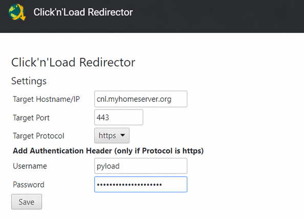

## Usage

Open Options and enter hostname or IP of the machine running pyload

## Non-https pitfalls

If the browser blocks an HTTP target request from an HTTPS source page as mixed content, allow mixed content for that source site in Firefox, or configure an HTTPS target when available.

Visit some page which uses Click n Load

Wait until page gets green

## Changelog

### v1.0.0
  2026-04-22

  * forked from https://github.com/werty1st/Redirect-Click-n-Load
  * renamed to Click'n'Load Redirector
  * added option to set the Host header to localhost
  * prevent redirect loop

### v1.0.1
  2026-06-22
  * fix incorrect element ID reference that caused setting not to be saved

### v1.0.2
  2026-10-13
  * fixed issue where the target request `Host` header was not correctly rewritten

### v1.0.3
  * added option to bypass Content Security Policy (CSP) when redirecting Click'n'Load requests
  * refactor settings page for better user experience

## Troubleshooting

* check if plugin is enabled (not paused)
* check if target is running and accessible
* check options if target hostname is still set
* check options if "Bypass Content Security Policy (CSP)" is enabled

Video https://www.youtube.com/watch?v=BLyknZbai5g&feature=youtu.be
